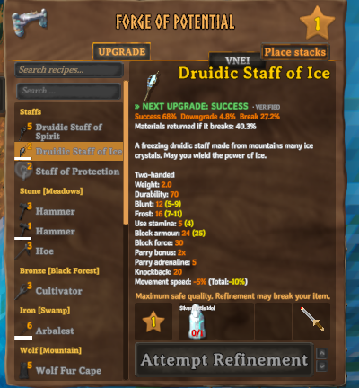
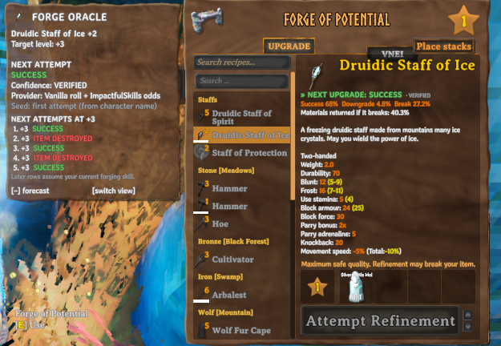
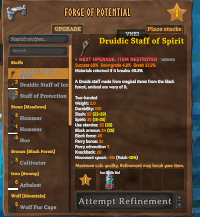

# Forge Oracle Client

Open a Forge of Potential, select an item, and Forge Oracle Client tells you what the next upgrade will do before
you click: success, a lost level, or a destroyed item.

Forge of Potential results are not random at the moment you click. Every item type and target level has a seed
stored on your character, and the game turns it into the roll. The mod reads that seed from the running game and
replays the same calculation on its own copy of Unity's random generator. It reveals a result that is already
fixed; it never changes it. It only runs on your client and never touches your items, seeds or odds.

## Screenshots







## Features

- The prediction is the first line of the forge's own item description, in the game font:
  `» NEXT UPGRADE: SUCCESS`, `× NEXT UPGRADE: ITEM DESTROYED`, `« NEXT UPGRADE: LEVEL -1`. Symbol, word and color
  each carry the meaning; a colorblind palette is available.
- An optional panel next to the forge (`F8`) with the item, target level, exact roll and odds, confidence, the
  mod that decides the odds, and a forecast of up to 20 rows:
  - **Next attempts at this level:** what the following attempts at the same level give, with any copy of the item.
  - **Level by level:** the first attempt at each higher level, assuming every earlier step succeeds. Rows after a
    predicted failure are greyed out, since the item would not get there.
- Works with any item the forge lists, vanilla or modded (Warfare, Armory, Monstrum, ValheimArmory and others),
  because it uses the same internal item name the game uses.
- Reads the odds the game will really use, including
  [ImpactfulSkills](https://thunderstore.io/c/valheim/p/MidnightMods/ImpactfulSkills/) forging bonuses and the
  PotentialReforged and ForesightForge rules. When another mod replaces the roll itself, it says
  `PREDICTION UNAVAILABLE` instead of guessing.
- Every prediction is labelled VERIFIED or UNVERIFIED, and the panel says why.
- At startup it checks its random generator against Unity's real one on 256 seeds, leaving the game's own random
  sequence untouched.
- After each real attempt, the BepInEx log shows the prediction next to what happened.
- English and Spanish, following the game language.

## Controls

| Key | Action |
|---|---|
| Select an item at the forge | Shows the prediction |
| `F8` | Show or hide the panel |
| Drag the panel title | Move the panel (the position is remembered) |
| `[+] forecast` / `[−] forecast` | Show or hide the forecast table |
| `[switch view]` | Switch between the two forecasts |

The upgrade button is not changed. An optional setting asks for a second click when the next attempt is predicted
to destroy the item.

## Installation

Install with r2modman, Gale or the Thunderstore app. To install by hand, put `ForgeOracleClient.dll` and
`ForgeOracle.Core.dll` in `BepInEx/plugins/ForgeOracleClient/`.

## Requirements and compatibility

- BepInExPack for Valheim. Built for Valheim 1.0.21.
- Client-side. The server does not need it and other players do not need it. The forge roll runs on the client of
  the player who upgrades, so predictions work on dedicated servers too. It adds no network traffic.
- [ImpactfulSkills](https://thunderstore.io/c/valheim/p/MidnightMods/ImpactfulSkills/) 0.23.0: supported and
  checked in game. Other versions show UNVERIFIED.
- PotentialReforged 1.1.1 and ForesightForge 1.0.0: supported from their code but not yet checked in game, so
  their predictions show as UNVERIFIED.
- ReforgedPotential: not predictable, because it rolls with the game's unseeded random generator. Predictions show
  as unavailable.
- Two forge overhauls at the same time: shown as unavailable.

## Configuration

The config file is `BepInEx/config/heido.valheim.forgeoracleclient.cfg`.

| Setting | Default | What it does |
|---|---|---|
| `Enabled` | true | Master switch |
| `Language` | Auto | Auto follows the game; or English, Spanish |
| `ToggleHotkey` | `F8` | Shows or hides the panel |
| `RefreshOnStateChanges` | true | Recompute after each attempt |
| `ShowCompactPrediction` | true | The line at the top of the forge description |
| `ShowConfidence` | true | VERIFIED / UNVERIFIED after the prediction |
| `ShowExactRoll` | false | Roll and odds in the panel |
| `ShowInternalPrefabId` | false | The internal item name the game uses |
| `ShowSeedTransitions` | false | Seed and next seed in each forecast row |
| `EnableTooltips` | true | Explains the forecast views |
| `ColorblindPalette` | false | Blue / orange / yellow instead of green / red / amber |
| `HideWhenUnverified` | false | Show PREDICTION UNAVAILABLE instead of an unverified prediction |
| `ShowDetailedPanel` | false | Show the panel |
| `ExpandedLayout` | true | Show the forecast table in the panel |
| `PredictionCount` | 5 | Forecast rows, 1 to 20 |
| `ForecastMode` | RepeatedAttempts | Or Progression |
| `PanelOpacity` | 0.9 | Panel background opacity |
| `UiScale` | 1.0 | Scale of the line and the panel |
| `Anchor` | Auto | Side of the forge panel; Auto picks the side with free space |
| `Draggable` | true | Allow dragging the panel |
| `ResetPanelPosition` | false | Set to true to move the panel back |
| `ConfirmPredictedDestruction` | false | Hold back the first click on an attempt predicted to destroy the item |
| `EnableSounds` | false | Click sound when a destruction becomes predicted |
| `RngSelfTest` | true | Startup check of the random generator; predictions are only VERIFIED when it passes |
| `ValidationLog` | true | Log the prediction and the result of every real attempt |
| `DebugLogging` | false | Extra lines in the BepInEx log |

## Console commands

Open the console with `F5`:

- `forgeoracle status` shows the plugin and game version, the forge implementation, the selected item and the
  confidence.
- `forgeoracle item` shows the internal name, key and seed source of the selected item and the idol odds.
- `forgeoracle predict 10` prints the next 10 rows of both forecasts.
- `forgeoracle providers` lists the supported forge mods and every patch other mods put on the forge.
- `forgeoracle history` lists this session's attempts with MATCH or MISMATCH.
- `forgeoracle refresh`, `selftest`, `debug`, `reload` and `resetpanel` do what their names say.

## How it works

```text
key  = hash(item's internal name) + target level
seed = seed stored on the character for that key, or hash(character name) + key
roll = Unity Random.value after InitState(seed); the next seed is Random.Range(0, 99999999)
success   if the idol's upgrade chance >= roll
destroyed if the idol's break chance   >= 1 - roll
otherwise the item loses one level
```

The details, read from the game code, are in [docs/FINDINGS.md](docs/FINDINGS.md). How other mods are detected is
in [docs/COMPATIBILITY.md](docs/COMPATIBILITY.md), and the in-game checks are in
[docs/VALIDATION.md](docs/VALIDATION.md).

## Known limits

- The forge refuses an attempt while your inventory lacks one free slot per recoverable material plus one. That is
  the game's own rule: free some slots if the button does nothing.
- With ImpactfulSkills, forging XP after each attempt can change the odds, so forecast rows after the first assume
  your current forging skill.
- A mod that changes the forge without Harmony patches and without touching the idol's odds cannot be detected.
- A game update can change the algorithm. The startup check and the validation log show it right away.

## Bugs and suggestions

Open an issue on the [project page](https://github.com/RodrigoPiston/ForgeOracleClient/issues). For a wrong
prediction, include the `[Validation]` line from `BepInEx/LogOutput.log`, the output of `forgeoracle status` and
`forgeoracle providers`, and your mod list. Character files are not needed.

## Credits

- **Forge Oracle** by papptimus (MIT): the web tool at <https://papptimus.github.io/Forge-Oracle/> and its source
  at <https://github.com/papptimus/Forge-Oracle> first documented the Forge of Potential seed table and how to read
  it ahead of time. Forge Oracle Client is an in-game, client-side take on that idea, and the web tool's reference
  code produced its test vectors. See [THIRD_PARTY_NOTICES.md](THIRD_PARTY_NOTICES.md).
- **ValheimSaveParser** by Melichor (<https://melichor.github.io/ValheimSaveParser/>), an independent analysis of
  the same mechanics.
- Unofficial fan project, not affiliated with or endorsed by Iron Gate AB.

## License

MIT, see [LICENSE](LICENSE). Building from source: [docs/DEVELOPMENT.md](docs/DEVELOPMENT.md).
